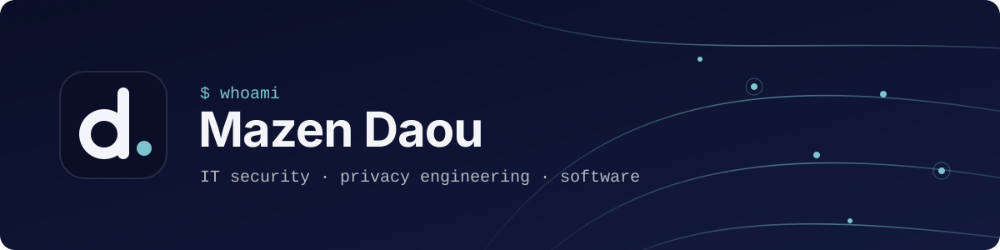
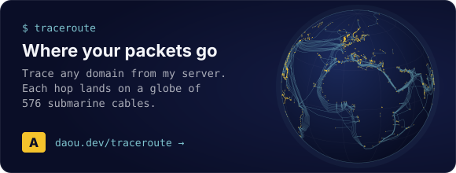

<a href="https://daou.dev"></a>

<p align="center">
  <a href="https://daou.dev"></a>
  <a href="https://www.linkedin.com/in/mazendaou/"></a>
  <a href="mailto:mazen@daou.dev"></a>
</p>

<p align="center"><i>I build tools that show what the web learns about you.</i></p>

```console
$ cat ~/record
IT Security M.Sc. student        TU Darmstadt
Working student                  Bosch Building Technologies · Frankfurt Airport
IT-security dual student (B.Sc.) Bosch Building Technologies · 3 years, completed
```

### `$ ls ~/exhibits`

<p>
  <a href="https://daou.dev/traceroute"></a>
  <a href="https://daou.dev/privacy-tools"></a>
</p>

### `$ ls ~/tools`

<p>
  
  
  
  
  
  
  
  
  
</p>

<p>
  
  
  
  
</p><sub>Most of my work lives in private repos. Ask if you'd like a look.</sub>
